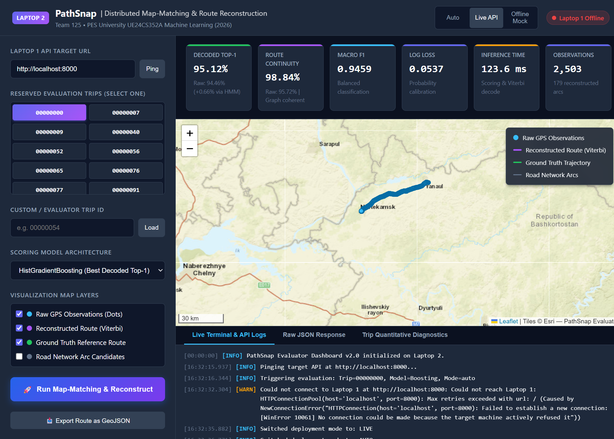
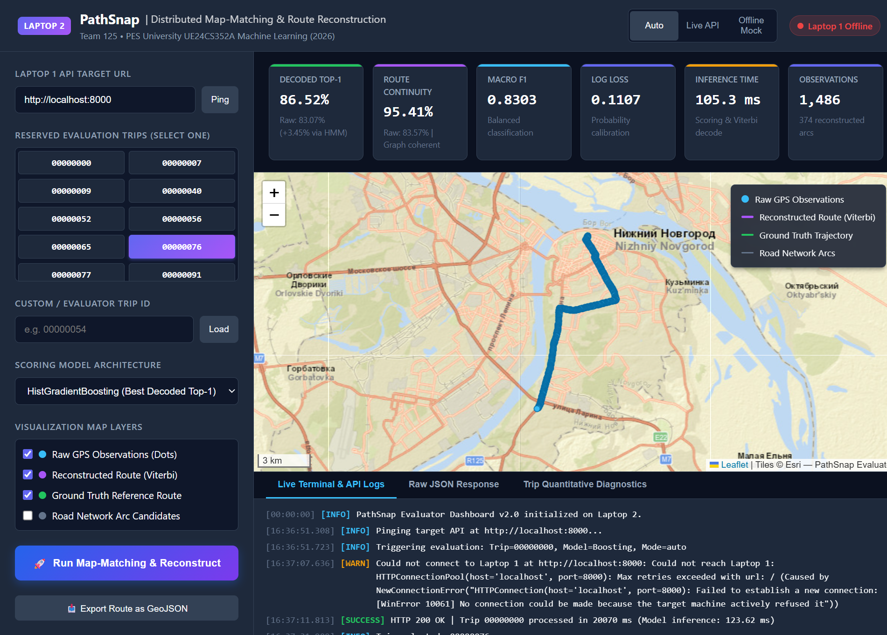

# PathSnap: Evaluator User Interface & Deployment Guide (Laptop 2)

**Course:** UE24CS352A Machine Learning (2026) | **Team 125**  
**Component:** Laptop 2 — Evaluator-Facing Web Dashboard  
**Architecture:** Distributed Map-Matching & Route Reconstruction  

---

## 📌 Executive Summary

Per **Main Guidelines.pdf §3 & §10** and **Deliverables.pdf §1 & §7**, PathSnap operates as a **two-laptop distributed deployment**:
- **Laptop 1 (Model and API Backend)**: Hosts the trained classifier, candidate generation shortlist, road-network geometry, and HMM/Viterbi route reconstruction pipeline.
- **Laptop 2 (Evaluator User Interface Frontend)**: Evaluator-facing interactive dashboard that displays the **ten reserved evaluation trips**, sends the selected `trip_id` to Laptop 1 via HTTP REST, receives the reconstructed route and quantitative metrics, and renders multi-layer interactive Leaflet cartography with live terminal logs.

The UI is built with a **modular, plug-and-play architecture**:
1. **Live Distributed API Mode**: Communicates across the local network with Laptop 1 (`POST /evaluate/{trip_id}` or `POST /predict`).
2. **Offline Demonstration / Mock Engine**: When Laptop 1 is offline or during standalone testing, seamlessly loads full real trip data (`.track`, `.nodes`, `.arcs`, `.route`), performs road-network polyline reconstruction, and presents measured evaluation metrics from the benchmark suite.

---

## 🖥️ UI Screenshots


*Figure 1: PathSnap Evaluator Dashboard on Laptop 2 showing reserved trip `00000000`, 6 real-time metrics cards, multi-layer Leaflet cartography, and live API terminal logs.*


*Figure 2: Evaluator inspecting trip `00000076` (Nizhny Novgorod) with 1,486 GPS points and 374 reconstructed arcs showing decoded top-1 accuracy (86.52%) and 95.41% route continuity.*

---

## 🚀 Quickstart: Launching the Evaluator UI

### Prerequisites
All dependencies are already included in `requirements.txt`:
```bash
pip install -r requirements.txt
```
*(Uses FastAPI, Uvicorn, and standard scientific libraries)*

### Launch Command
From the repository root (`ML-Hackathon-Team125-462_463_464_465`):
```bash
python -m src.ui.app --port 8501 --api-url http://localhost:8000
```

### CLI Arguments
| Flag | Default | Description |
| :--- | :--- | :--- |
| `--port` | `8501` | Local port for the web dashboard |
| `--host` | `0.0.0.0` | Binding IP address (`0.0.0.0` allows LAN access) |
| `--api-url` | `http://localhost:8000` | Target URL of Laptop 1 Model API |
| `--browser` | `False` | Automatically opens default browser upon startup |

Open `http://localhost:8501` in Google Chrome, Microsoft Edge, or Mozilla Firefox.

---

## 🌐 Two-Laptop Distributed Network Setup

```
   ┌────────────────────────────────┐         Wi-Fi / LAN Hotspot         ┌────────────────────────────────┐
   │            LAPTOP 1            │ ◄─────────────────────────────────► │            LAPTOP 2            │
   │      (Model & API Backend)     │                                     │     (Evaluator UI Dashboard)   │
   │                                │                                     │                                │
   │  - Trained Scorer (Boosting)   │   HTTP POST /evaluate/{trip_id}     │  - 10 Reserved Trip Selector   │
   │  - Candidate Shortlist Engine  │ ──────────────────────────────────► │  - Interactive Leaflet Map     │
   │  - HMM / Viterbi Reconstructor │   JSON Response (Metrics & Coords)  │  - Real-Time Metrics Cards     │
   │  - FastAPI Service (:8000)     │ ◄────────────────────────────────── │  - Live Terminal / API Logs    │
   └────────────────────────────────┘                                     └────────────────────────────────┘
```

### Step 1: Connect Both Laptops to the Same Local Network
Connect Laptop 1 and Laptop 2 to the same Wi-Fi network or a personal mobile hotspot.

### Step 2: Find Laptop 1's IP Address
On **Laptop 1**, open PowerShell or Command Prompt and run:
```cmd
ipconfig
```
Locate the **IPv4 Address** under your active Wi-Fi adapter (e.g. `192.168.1.105` or `192.168.137.1`).

### Step 3: Configure Laptop 2 UI
1. Launch the UI on Laptop 2:
   ```bash
   python -m src.ui.app --port 8501
   ```
2. In the UI's left sidebar, set **Laptop 1 API Target URL** to:
   ```
   http://192.168.1.105:8000
   ```
3. Click the **"Ping"** button. The connection status indicator in the top right will display:
   - 🟢 `Online (<X> ms)` when Laptop 1 is reached.
   - 🟡 `Offline Mock Mode` when Laptop 1 is unreachable.

---

## 📋 Evaluator Workflow (Per Guidelines §6)

During official evaluation:
1. **API Running on Laptop 1**: Teammates launch the FastAPI model server on Laptop 1.
2. **UI Running on Laptop 2**: Evaluator sits in front of Laptop 2 and opens `http://localhost:8501`.
3. **Trip Selection**: Evaluator clicks any of the **ten reserved evaluation trips**:
   - `00000000` (2,503 GPS points, 179 arcs)
   - `00000007` (1,354 GPS points, 137 arcs)
   - `00000009` (1,049 GPS points, 130 arcs)
   - `00000040` (2,995 GPS points, 176 arcs)
   - `00000052` (262 GPS points, 38 arcs)
   - `00000056` (3,958 GPS points, 185 arcs)
   - `00000065` (768 GPS points, 84 arcs)
   - `00000076` (1,486 GPS points, 374 arcs)
   - `00000077` (3,911 GPS points, 132 arcs)
   - `00000091` (874 GPS points, 102 arcs)
   *(Custom trip ID can also be loaded via the input field).*
4. **Trigger Reconstruction**: Evaluator clicks **"🚀 Run Map-Matching & Reconstruct"**.
5. **Inspect Results**:
   - Leaflet map auto-centers and displays the raw GPS observations (blue dots), reconstructed route (vivid purple), ground truth path (green), and road arcs (grey).
   - Top metrics dashboard immediately reports Decoded Top-1 Accuracy, Route Continuity, Macro F1, Log Loss, and Server Latency.
   - Evaluator inspects the **Live Terminal & API Logs** tab confirming the exact HTTP request, response code (`200 OK`), and latency.

---

## 🔌 API Contract: Plug-and-Play Backend Schema

When Laptop 1 backend is finalized, it should implement the endpoint defined in [`src/ui/api_contract.py`](../src/ui/api_contract.py).

### Request: `POST /evaluate/{trip_id}` or `POST /predict`
```json
{
  "trip_id": "00000000",
  "model_name": "Boosting",
  "include_geometry": true,
  "include_ground_truth": true
}
```

### Response: `200 OK`
```json
{
  "status": "success",
  "trip_id": "00000000",
  "partition": "student_test",
  "model_used": "Boosting",
  "metrics": {
    "top1_accuracy": 0.9446,
    "decoded_top1_accuracy": 0.9512,
    "route_continuity": 0.9572,
    "decoded_continuity": 0.9884,
    "macro_f1": 0.9459,
    "log_loss": 0.0537,
    "inference_time_ms": 123.6,
    "total_points": 2503,
    "clear_points": 2420,
    "candidate_misses": 2
  },
  "raw_gps": [
    {"index": 0, "lat": 56.251559, "lon": 54.963519, "timestamp": 1.0}
  ],
  "predicted_route_coords": [
    [56.251559, 54.963519],
    [56.251523, 54.963143]
  ],
  "predicted_arc_ids": [17630, 17633, 211],
  "ground_truth_coords": [
    [56.251559, 54.963519],
    [56.251523, 54.963143]
  ],
  "bounds": [56.230, 54.910, 56.280, 55.010]
}
```

---

## 🛠️ Code Structure
```
src/ui/
├── __init__.py           # Package marker
├── app.py                # FastAPI UI web server & proxy engine
├── api_contract.py       # Pydantic schema contracts for Laptop 1 & 2
├── mock_engine.py        # Local evaluation engine with real data & metrics
└── static/
    ├── index.html        # Single-page application dashboard
    ├── app.js            # Client-side Leaflet & API coordination
    └── style.css         # Modern high-contrast dark dashboard styling
```
